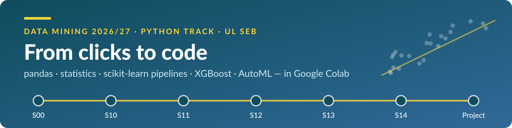

  
  
  
  
  
  
  

# 🐍 From clicks to code

**Data Mining 2026/27 · Python track** — University of Ljubljana, School of Economics and Business (UL SEB) · doc. dr. Uroš Godnov

In sessions 1–9 you built models by connecting operators in AI Studio. In sessions 10–14 you do the same — and more — **in Python**, the language data scientists use every day. Same ideas, new superpowers: any data from the web, full control over every step, and results anyone can reproduce with one click.

## 🗺️ The route

| | Session | When | Mission | Notebook |
|---|---|---|---|---|
| 🧰 | **S00** · Python warm-up | before 14 Dec · self-paced | Feel at home in Python — and find your lane in 20 minutes |  |
| 📥 | **S10** · Python for data mining | Mon 14 / Wed 16 Dec | From clicks to code: get any data in — and out |  |
| 🔍 | **S11** · pandas, EDA & statistics | Mon 21 Dec · Zoom | 119,390 hotel bookings: which patterns are real? |  |
| 🧹 | **S12** · Data preparation | Wed 23 Dec · Zoom | Model-ready data — without cheating |  |
| ⚖️ | **S13** · Models & generalisation | Mon 4 / Wed 6 Jan | Underfitting or overfitting? Models for data they have never seen |  |
| 🚀 | **S14** · XGBoost, AutoML & deep learning | Mon 11 / Wed 13 Jan | Boosting, decisions made with money — you vs. AutoML |  |
| 🏆 | **Homework 3** · Beat the AutoML | due Sun 17 Jan 2027 | Your Homework 1 problem — now in Python, against AutoML |  |

## ▶️ Start in two minutes

1. Click **Open in Colab** next to your session — nothing to install, it runs in your browser.
2. **File → Save a copy in Drive** — now the notebook is yours and every change is saved.
3. Run the first cells (🧰 *Course helpers*, ⚙️ *Setup*) and work from top to bottom. Lost the connection? *Runtime → Run before* brings you back.

## 🧭 Two lanes × two lenses

| | 💻 Business informatics | 📈 Economics with data analysis |
|---|---|---|
| **New to Python** | 🟢 Core — your SQL is a head start: `groupby` is GROUP BY, `merge` is JOIN | 🟢 Core for the code — your statistics is an advantage: read the 📈 boxes, try the 🧠 questions |
| **Already coding** | 🚀 Fast lane — start with the 💻 challenges: SQL on DataFrames, pipelines you can ship, tests for ML code | 🚀 Fast lane — start with the 📈 challenges: bootstrap, permutation tests, why an explanation is not a cause |

Everyone shares the same 🟢 **core** (Parts A and B). The 🚀 **fast lane** adds side quests and **Part C · Advanced track**: 35 challenges across the five sessions. Nothing marked 🚀 is graded.

## 🔤 Inside every notebook

| | | | |
|---|---|---|---|
| 🔮 **Predict** before you run | 🧪 **Try it** — a short exercise | ✏️ **TODO** — your task in Part B | ✅ ❌ ⏳ **Instant checks** — "Run all" never crashes |
| 🛟 **Rescue** cells — never stay stuck | 🚀 **Fast lane** — optional, harder | 📈 💻 **Two lenses** — economics or informatics | 🧠 **Think** — questions without code |

## 📦 Data

All data load from the web at run time: the UCI Machine Learning Repository (wine quality, building energy, Adult income, bank marketing, credit-card default), hotel booking demand (Antonio et al., 2019, via TidyTuesday), Ames house prices (De Cock, 2011, via OpenML), the IBM Telco churn sample, Open-Meteo weather and Eurostat (HICP). Each notebook credits its sources.

---

Solutions, session guides and the homework rubric are on the course's Canvas page for enrolled students. © 2026 Uroš Godnov · teaching materials for Data Mining 2026/27 at UL SEB.
